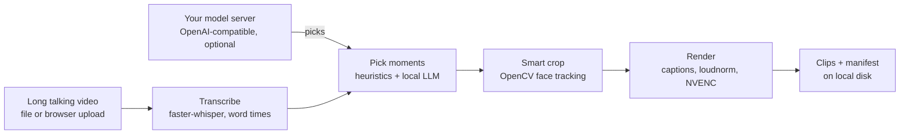

# kodros-localclip

Cuts a long talking video into short captioned clips on your own machine. It transcribes the audio, picks the strongest moments, follows the speaker's face for a vertical crop, burns in word-by-word captions and evens out the loudness. Your video never leaves the computer.

## Hardware and on-prem

- Linux with `ffmpeg`, Python 3.11 or newer. An NVIDIA GPU is optional but speeds it up. On an RTX 4080 (16 GB), the author measured about 1 GiB of VRAM for Whisper `small` and about 380 MiB for the NVENC encode. Without CUDA it falls back to CPU Whisper and `libx264`, which is slower.
- Moment picking can use a local language model through any OpenAI-compatible endpoint (llama.cpp server, vLLM, Ollama and similar). The VRAM that costs is whatever model you serve. A Llama, Gemma or gpt-oss model works the same way. The author's own runs used a DeepSeek model, which is of non-US origin. With `--no-llm` it picks by heuristics alone and needs no model server.
- The web editor binds `127.0.0.1`, rejects foreign Host and Origin headers and loads nothing from a CDN. The only outbound calls are to the model URL you set (default `http://127.0.0.1:8080/v1`) and an optional local speech service. The one exception is the first run: faster-whisper downloads the Whisper weights from Hugging Face. Set `HF_HUB_OFFLINE=1` once they are cached.

## How it works



The picker scores every 20 to 60 second window that starts and ends on a sentence boundary. The top 12 diverse windows go to the model, which returns the final clips with a title and a reason. Missing or invalid answers fall back to the heuristic score. Each clip records which one chose it. Every export writes `clipNN.mp4` plus a `manifest.json` with timestamps, transcript, crop mode, loudness and encoder.

## Stack

Python 3.11, faster-whisper, OpenCV (headless, below version 5), NumPy, a standard-library web server with a plain JS editor, `ffmpeg` with libass for captions.

## Build and run

```bash
git clone https://github.com/thefiredev-cloud/kodros-localclip.git
cd kodros-localclip
python3 -m venv .venv && . .venv/bin/activate
pip install -e '.[gpu,test]'          # drop ,gpu on a machine without CUDA
python -m pytest -q                   # full suite, no models or services needed
localclip make talk.mp4 --count 3 --aspect 9:16
localclip serve                       # web editor on http://127.0.0.1:8871
```

Set the model server with `LOCALCLIP_LLM_URL` and `LOCALCLIP_LLM_MODEL`. [BUILD.md](BUILD.md) has every command, setting and the pipeline stages.

## Limits

- No speaker diarization. Face tracking follows the largest frontal face.
- Caption style is fixed. A custom end card is CLI only.
- No B-roll, templates, scheduling or posting to social accounts.
- One job runs at a time. Set `LOCALCLIP_GPU_BLOCK` to a comma-separated list of process names (for example `blender,comfyui`) and LocalClip stays off the GPU while any of them runs. It is empty by default, so nothing is blocked.

## License

Copyright 2026 Tanner Osterkamp. All rights reserved. See [LICENSE](LICENSE). The source is public to read; ask before reuse.
